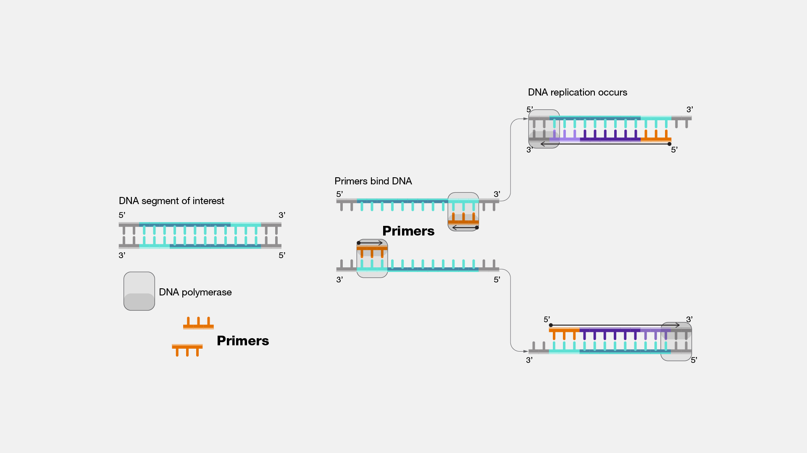

# Project Diary: Do early SARS-CoV-2 qPCR primers still match later variants?

02-120 Programming for Scientists · Isabel Guo

One log per version of the model, see also `modification documentation.md`.
The numbers in brackets, like **(#2)**, point to its matching numbered items.

---

## Log 1 · 2026-10-29 · Version 1: First model, factor: specificity

**Commit:** `8e3f1c3`

### What the model does, in plain words

A PCR test works by two short pieces of DNA, called **primers**, sticking to
the virus's genome and copying the stretch between them. If the virus
mutates where a primer sticks, the primer may not stick anymore, and the test
can miss the virus.

This first model asks one simple question: **"Where would these two primers
stick, and would they copy anything?"**

1. **Make a lookup table of the genome.** Like the index at the back of a
   book, it records where every short 5-letter word appears, so the program
   doesn't have to read the whole genome for every primer.
2. **Find where each primer sticks.** It looks on both strands of the DNA
   (DNA is double-stranded, and a primer can stick to either one) and lets
   you choose how many wrong letters (mismatches) are still OK. That setting
   is marked with a star banner so it's easy to find **(#1)**.
3. **Say where the mistakes are.** Each mismatch is counted from the primer's
   **3' end**, the end where copying starts. A mistake there matters most.
4. **Pair the primers into products.** A copy (product) is only made when
   one primer points right, the other points left, and they face each other
   at a sensible distance.

It was tested on **made-up primers and a made-up DNA sequence**, so every
answer could be worked out by hand first (7 test cases).

**Not included yet:** melting temperature, primer dimers, real genomes.

### Core functions
| Function | What it does |
|---|---|
| `reverse_complement` | Gives the other DNA strand, so primers can be found on both strands |
| `build_kmer_index` | The lookup table: where every 5-letter word appears |
| `find_binding_sites` | Finds every spot a primer sticks within the mismatch allowance |
| `distances_from_3prime` | Counts each mismatch's distance from the 3' end |
| `pair_into_products` | Pairs facing sites into PCR products |
| `predict_products` | Runs the whole model in one call |

---

## Log 2 · 2026-10-29 · Version 2: Handling bad sequencing data

**Commits:** `81d909e`, `504d494`

### What I did
- Stopped counting unknown bases (N) as mutations. Before, missing data
  could make a primer look lost. Each primer now gets one of three outcomes:
  binds / mismatched / not assessable **(#2)**.
- Made the model find primer sites that run off either end of a sequence,
  and mark them "not assessable" **(#3)**.
- Added a safeguard so a long run of Ns can't make every primer
  "not assessable" **(#4)**.
- Wrote `test_cases_specificity.txt`, which explains every test case, and
  added 4 new tests (Cases 7-10) **(#5)**.
- Renamed the bad-data note in the code to "HANDLING BAD SEQUENCING DATA"
  **(#6)**.

### New core functions
| Function | What it does |
|---|---|
| `compare_site` | Splits differences into real mismatches vs unknown bases |
| `candidate_starts` | Also checks spots near Ns and at the sequence ends |
| `primer_outcome` / `assay_outcome` | Give the three outcomes for each primer and the pair |

---

## Log 3 · 2026-10-30 · Version 3: Explaining failures

**Commit:** `fcf677c`

### What I did
- Fixed a bug: if one primer can't bind anywhere, the answer is now
  "no product", not "not assessable" **(#7)**.
- Added a warning for mismatches near the 3' end **(#8)**.
- Added a probe check. A qPCR signal needs the probe to bind inside the
  product; if it doesn't, the outcome is "no signal" **(#9)**.
- Allowed degenerate bases in primers, e.g. Y = C or T, used by the CDC N3
  probe **(#10)**.
- Showed each mismatch as a base change, e.g. "primer C, genome G" **(#11)**.
- Added a near-miss report: where a failed primer almost bound, including
  one insertion or deletion **(#12)**.
- Printed positions counting from 1, like the CDC table **(#13)**.
- Added 10 new tests (Cases 11-19) **(#14)**.
- While testing, found that the near-miss search can't always find a
  near-miss **(#15)**, and that on random DNA it found fake matches. I added
  stricter rules so it no longer does **(#16, #17)**.

### New core functions
| Function | What it does |
|---|---|
| `run_model` | Replaces `predict_products`; returns sites, products, outcomes, near-misses, warnings |
| `expand_degenerate` / `base_matches` | Handle degenerate primer letters |
| `describe_changes` | Writes each mismatch as a base change |
| `find_near_miss` | Finds the closest site for a failed primer |
| `gapped_pairs` / `placements` | Line a primer up across an insertion or deletion |
| `probe_inside` / `product_status` | Check the probe and label each product |

---

## Log 4 · 2026-10-30 · Version 4: Smarter logic and the first real data

**Commit:** `8af20dc`

### What I did
- Made the model say "binds" when missing data can't change the answer. If a
  site still fits even when every N counts as a mismatch, it binds **(#18)**.
- Made the model read ambiguity codes in the genome, e.g. genome R (A or G)
  can never match a primer C **(#19)**.
- Graded mismatches as severe or mild, using published PCR studies. The 3'
  warning is now graded high / low / possible **(#20)**.
- Let a 1-base gap near the primer's 5' end still bind **(#21)**.
- Ran the model on real data for the first time. CDC N1, N2 and N3 on the
  reference genome each give exactly one product in the right place, and
  every probe binds. The human RNase P control gives none **(#22)**.
- Found an open question: N1 comes out at 72 bp, but the primer table says
  73 bp, even though its own coordinates span 72 **(#23)**.
- Proved the fast search is complete: it matched a slow check of every
  position in 600 searches. I also saved the random-DNA check as a test
  **(#24, #25)**.
- Split the model and the tests into separate files **(#26)**.
- Fixed small wording in the report ("1 base", not "1 bases") **(#27)**.

### New core functions
| Function | What it does |
|---|---|
| `genome_vs_primer` | Decides match, mismatch or unknown for any genome letter |
| `mismatch_severity` | Grades a mismatch severe or mild |
| `three_prime_risk` | Grades the 3' end: high, low or possible |
| `find_indel_sites` | Finds sites that bind through a small 5' gap |
| `read_fasta` | Reads a real genome file |
| `check_viral_assay` (in `cdc_reference_check.py`) | Checks one CDC assay on the reference genome |
| `brute_force_sites` (in the test file) | The slow every-position search used to prove the fast one |

---

## Log 5 · 2026-10-30 · Documentation (no model change)

**Commits:** `bfaff5d`, `526c2a5` (the restore), `1a78e66` (the README update), `289fb03` (the session log)

### What I did
- Started this diary.
- Turned the modification documentation from a `.txt` into a `.md` file, so
  it displays with headings on GitHub **(#28)**.
- Lined this diary up with the modification documentation so the two can be
  read side by side **(#29)**.
- Added a "Things to work on for next time" list, and set the rule that both
  documents get updated with every commit **(#30)**.
- My editor saved an older copy of this diary over the new one; I restored
  the full version and kept my shorter intro **(#31)**.
- Renamed the README title to "02120 qPCR primers and covid-19" and shortened
  item #1 in the modification documentation **(#32)**.

### Things to work on for next time
- Settle the N1 size question (72 vs 73 bp) by checking Lu et al. (2020)
  **(#23)**.
- Run the CDC primers on the Alpha, Delta and Omicron genomes, which is the
  real question of the project.
- Add the positive control from the proposal: a primer across Alpha's spike
  69-70 deletion must fail on the Alpha genome.
- Start the next factor: melting temperature with the nearest-neighbor model,
  checked against the Primer3 values in `data/primers/`.
- Make the mismatch allowance something you can set when running the program,
  not only in the code.

---

## Log 6 · 2026-10-30 · First variant results (quick first pass)

**Commits:** `f0b44dd`, `761fe07` (#35), `5834b32` (#36), `7892816` (#37 and the session logs)

### What I did
- Wrote a quick script, `variant_check.py`, that runs the CDC N1, N2 and N3
  assays on the reference and on the Alpha, Delta and Omicron genomes and
  prints one table **(#33)**. ⚠ Later found that my "Alpha" genome is really
  Beta, so the Alpha results here are Beta results **(#42)**.
- First answer: all three assays still give a product on all three variants,
  at the same sizes as on the reference. The only change is one mismatch in
  the N1 probe on Omicron, and no primer has a mismatch near its 3' end
  **(#33)**.
- Renamed the genome files to clean `.fasta` names, so the program can find
  them and the names say which variant each one is **(#34)**.
- Set git to ignore Mac `.DS_Store` files and Python's `__pycache__` folder,
  so they stop showing up as changes **(#35)**.
- Settled the N1 size question: the primer positions span 72 bases, the
  genome gives 72, and an outside database also says 72, so the 73 in my table
  was a typo. I changed it to 72 and every CDC check now passes **(#36)**.
- Found where the Omicron N1 probe mismatch is: genome position 28311, a C
  changed to T, the 3rd base of the probe. It is a known Omicron mutation
  (N:P13L), not just something odd about my one genome **(#37)**.
- Learned that my model only uses the number of mismatches to decide
  "binds". How bad a mismatch is and its 3' risk are only shown as warnings,
  so I need to read that column too **(#37)**.
- Went over the qPCR background: primers on opposite strands, cycles, Ct
  (the cycle where the signal crosses the threshold), ΔCt and ΔΔCt with a
  reference gene, fold change = 2^(−ΔΔCt), why the threshold sits in the
  exponential phase, melting temperature (Tm), and how a TaqMan probe makes
  the signal.

### Things to work on for next time
- Use more than one genome per variant, since one isolate may not be typical,
  and check that the C28311T change is in other Omicron BA.1 genomes too.
- Add the positive control from the proposal: a primer across Alpha's spike
  69-70 deletion must fail on the Alpha genome.
- Start the next factor: melting temperature (Tm) with the nearest-neighbor
  model, checked against the Primer3 values in `data/primers/`. Then work out
  each primer's Tm on each variant (mismatches lower it) and compare it with
  the test's annealing temperature (about 55 °C in the CDC protocol; check
  this). A Tm that drops close to it means the primer binds poorly.
  - The SantaLucia table I have is for 1 M salt, but the Primer3 values used
    50 mM salt and 3 mM magnesium, so I need a salt correction before the
    numbers can match.
  - I also need the mismatch values (Allawi & SantaLucia), since my table
    only has perfectly matched pairs.
  - Start with the N1 probe on Omicron: how much does C28311T lower its Tm?
- Look at the probe separately. A TaqMan probe only gives light if it is
  bound when the polymerase reaches it, so a weaker probe can make the Ct
  come later and the virus look like less than it is, even when the primers
  work fine.
- Go one step past Tm: work out how much of the primer is bound at the
  annealing temperature, as a step toward predicting a Ct shift.
- Maybe let a high 3' risk change the result instead of only showing a
  warning.
- Later: hairpins and primer-dimers, the RT step, and the CDC run conditions.
- Maybe add a spike-targeting primer set to compare with the CDC N assays. My
  idea: spike changes faster because the virus gains from escaping immunity
  there, while the N gene regions the CDC picked are more constrained. So a
  spike primer should pick up more mismatches across Alpha, Delta and Omicron.
  This happens over months as new variants take over, not in a few rounds of
  copying. A primer across Alpha's spike 69-70 deletion would also be the
  positive control above.

---

## Log 7 · 2026-11-09 · Realistic test primers and k = 6

**Commit:** `0e0e449`

**Note:** most primers used in real life are 18-30 letters (bases) long:
long enough to stick to only one place in a genome, short enough to stick
quickly. The CDC primers and probes are 18-24 letters.

### What I did
- Noticed my made-up test primers were only 16 letters long, while real qPCR
  primers are 18-30. The 16 had no real reason behind it, so I redid every
  hand-solvable test with new made-up primers of 18, 20, 24 and 30 letters
  and a 26-letter probe, and worked out every answer again **(#38)**.
- A new test shows the same 6-letter deletion is spotted in a 30-letter
  primer but not in an 18-letter one, because too few letters would be left
  to be sure it is not chance **(#38)**.
- Learned what the lookup table's word length (k) does. The program cuts each
  primer into pieces (one more piece than the mismatches allowed), so at least
  one piece must match exactly (the pigeonhole principle), and looks up the
  start of each piece. Every piece must be at least k letters long **(#39)**.
- Changed k from 5 to 6. Longer words match fewer random places, so the
  program is faster (tests: ~18 s down to ~10 s), and all real primers are
  long enough. The CDC and variant results did not change **(#39)**.
- The cost: when a primer fails, the "where did it almost stick" search can
  now miss a site whose mismatches leave no 6-letter stretch intact. A new
  test shows a case that k = 5 finds and k = 6 misses **(#40)**.

---

## Log 8 · 2026-11-09 · 3' risk changes the result; a mislabelled genome

**Commit:** `e6793bf`

### What I did
- Made a bad mismatch at a primer's 3' end count. Before, it was only a
  warning and the product still looked fine. Now such a product is
  **"at risk"**: it may still copy, but worse. A clean product always ranks
  above an at-risk one, and later, on my website, primer pairs that are at
  risk will be flagged and suggested last **(#41)**.
- Looked for a published primer set on the spike gene and found the Yale
  spike 69-70 assay (Vogels et al. 2021). Its probe sits right across Alpha's
  6-letter deletion, so it should fail on Alpha.
- It did not fail on my "Alpha" genome. Checking the spike mutations showed
  why: the file has all of Beta's mutations and none of Alpha's. The wrong
  genome had been saved as Alpha. I renamed it to Beta and flagged the old
  Alpha results as Beta results **(#42)**.
- Omicron BA.1 does have the 69-70 deletion: the spike primers still copy
  the DNA there, but the probe cannot bind, so the test gives no signal.
- Took a quiz on the whole program (15 questions, then review rounds), saved
  in the session log. What I had to fix in my head:
  - **Severity** is the kind of one wrong pair (A/A, G/A, A/G, C/C are
    severe), not how many mismatches there are.
  - **3' risk** looks only at the last 3 letters. "At risk" needs a mismatch
    that is both severe *and* within 3 of the 3' end. A mild one there is
    only "low", and a severe one further in is ignored by 3' risk.
  - The order of checks is **count → window → severity**. "Mismatched"
    (too many changes, so no product) and "at risk" (the product forms) can
    never both happen.
  - A 1-letter deletion is allowed only in the 5' half of a primer. It has no
    severity and never makes a product "at risk".
  - **"No signal"** means the DNA is still copied, but the probe cannot bind,
    so nothing lights up.
  - The "Alpha" mix-up mattered because the results were right but had the
    wrong name. Checking the file showed Beta's mutations, not just a missing
    Alpha deletion **(#41, #42)**.

---

## Log 9 · 2026-11-10 · Second model: annealing temperature

**Commit:** `b585a97`

### What I did
- Built my second model, `second_model_annealing_temp.py`. The first model
  only says whether a primer fits within 2 mismatches. This one asks whether
  the primer is actually stuck to its site at the PCR's annealing
  temperature (55 C in the CDC protocol) **(#43)**.
- It works out the melting temperature (Tm) by adding up the energy of each
  pair of neighboring base pairs (the nearest-neighbor model), then corrects
  for salt and magnesium. My Tm values match Primer3's for all 11 CDC
  primers and probes to 0.01 C **(#43)**.
- Added published tables for mismatched pairs, so a variant's real binding
  site can be scored with its mismatch in place. Sites with an insertion or
  deletion, or two mismatches side by side, are not scored yet **(#44)**.
- From the Tm, the model works out what fraction of sites have a primer
  bound at 55 C. A product whose primer is mostly unbound is
  **"weak binding"**. If only the probe falls off, it is **"no signal"**
  **(#45)**.
- Learned that a bad mismatch at the very 3' end lowers Tm by less than
  half a degree. The primer still sticks; it just can't be extended. That is
  why the first model's "at risk" and this model's Tm are both needed
  **(#45)**.
- First result: the Omicron N1 probe mutation lowers its Tm by 6.8 C (71.2 to
  64.3 C). That is still about 9 C above 55 C, so the probe should still
  bind and all three CDC assays still give a product **(#45)**.

### Things to work on for next time
- Get a real Alpha genome and confirm the "Beta" file with Nextclade (#42).
- Save the Yale spike Δ69-70 primers in `data/primers/` and run them through
  both models.
- Use the CDC's real concentrations (500 nM primers, 125 nM probe) and Mg2+.
- Add bulge-loop and tandem-mismatch parameters so indel sites get a Tm.
- Turn the probe's weaker binding into an expected Ct delay.
- Point git at the repo's new address
  (`02120-qPCR-primers-and-covid19`).

---

## Log 10 · 2026-11-11 · Check-in practice (no model change)

**Commits:** `6da5ebe`, then `ade42ee` (#46, the primer image and the
session logs)

### What I did
- Practised explaining the first model for my check-in, one question at a
  time: the inputs, the three levels of outcome (each oligo, each product,
  the whole assay), the k-mer search and the pigeonhole argument, count →
  window → severity, pairing sites into products, and the CDC reference
  check.
- Worked hand examples on severity. The step I kept skipping: complement
  the genome letter to get the template base *first*, then check the pair
  against the severe list (A/A, G/A, A/G, C/C) **(#20, #41)**.
- Worked out which strand each primer binds, using this picture:

  
  *Image: NHGRI Talking Glossary, "Primer",
  <https://www.genome.gov/genetics-glossary/Primer>*

  - The **reverse primer** is complementary to the + strand (top, 5'→3'),
    so it binds the + strand and extends leftward.
  - The **forward primer** has the same sequence as the + strand, so it
    binds the − strand (bottom) and extends rightward.
  - The two primers point toward each other, so each copies across the
    other's site. That makes the product.
  - In the model, `strand +` / `strand −` say whether the primer's
    *sequence* matches the genome as written (+) or only after reverse
    complementing (−). It is never the strand the primer sticks to, which
    is always the other one. A product needs a + site on the left and a −
    site on the right, 20-1,000 bases apart.
- Changed the demo at the bottom of the first model so I can watch it work.
  It runs the model once on a sample genome, prints `running <function>`
  for each step (repeat calls grouped with a count), and ends with
  `return output = ` and everything the model returns **(#46)**.

### Things to work on for next time
- Use more than one genome per variant (#33).
- Get a real Alpha genome (#42).
- Remember the search can't find a site whose differences break every
  6-base seed (#15, #40).
- Save the Yale spike Δ69-70 primers in `data/primers/` and run them.
- In model 2, work out Tm for sites with an insertion or deletion (#44).
- Rename the project folder so it has no space. The Run button breaks on
  `programming project` and never runs the file, so it prints nothing.
- Practise reading the demo trace: say what each `running` step does and
  where the forward, reverse and probe sites come from (#46).

---

## Log 11 · 2026-11-13 · Primer design from the first model

**Commit:** `19b27c0`

### What I did
- Started on a website idea: paste a genome, a target gene and a mismatch
  allowance, and get back primers and a probe. Before building the website,
  I made the code that does the designing, `primer_design.py`.
- The first model *checks* primers someone else designed. This one goes the
  other way: it *designs* a forward primer, a reverse primer and a probe for
  a target gene, then uses the first model to check them **(#47)**.
- I kept it to what the first model knows: the sequence, the mismatch
  allowance, where things bind on both strands, the product length, and the
  probe being inside the product. No melting or annealing temperature. A
  first draft borrowed Tm from the second model, and I took it out
  **(#47)**.
- How it designs: every 20-base stretch of the target can be a forward
  primer, and its reverse complement a reverse primer. Pairs that make a
  60-150 bp product get a 24-base probe in the middle. A design is kept only
  if each primer and the probe stick in exactly one place on the whole
  genome, and the first model finds just the one product **(#47)**.
- The first three designs were the same pair shifted by one base, so now
  the designs can't overlap each other **(#48)**.
- Added GC content, because G-C pairs hold on with three bonds and A-T with
  two, so GC-rich primers stick too hard, even where they only partly
  match. The target's GC is checked first, before anything else runs: above
  70% the program stops and says why; 60-70% it carries on with a warning.
  Each primer and probe gets the same bands: above 70% is never used, and
  60-70% is used but flagged **(#49)**.
- GC was rounded to whole numbers, so 69.6% printed as "70 %" next to the
  word "medium". Now it shows one decimal **(#50)**.
- Ran 12 fake-genome test cases (`test_primer_design.py`); all pass. The
  first run failed once, but the bug was in my test: it counted the target
  warning as a primer warning because both contain the word "design"
  **(#51)**.
- Tried the CDC N1, N2 and N3 primers. They all pass the designer's rules:
  one site each, one product, probe inside, GC 40-58%. But the designer
  does not come up with them. It only makes 20-base primers and likes
  100 bp products; the CDC used 18-24 bases and 67-72 bp products
  **(#52)**.

### Things to work on for next time
- Let the designer make 18-24-base primers and 20-30-base probes, aim for
  products of about 70 bp, and report where the CDC design ranks among its
  options (#52).
- Add a test where every stretch of the target is 60-70% GC, so a design
  has to use a medium-GC primer and gets its own warning (#51).
- Decide whether very low GC (AT-rich primers bind weakly) should also give
  a warning (#49).
- Move the CDC published-primer check into `journal/`, and add RNase P once
  the human RPP30 segment is downloaded from NCBI (#52).
- Build the website: a genome box, a target box and an allowance box (0-2).
- Commit the new files and fill in Log 11's commit hash.

---

## Log 12 · 2026-11-13 · Primer design: lengths, the 40-60% GC rule, ranking

**Commits:** `3f629ea`, then `24f6899` (`troubleshooting.txt`, #58)

### What I did
- Gave primers a length range instead of always 20 bases: primers 18-24,
  probes 18-30. 18 is the shortest, because the first model needs each
  primer to split into three 6-base seeds when 2 mismatches are allowed
  **(#53)**.
- A range on its own gives too many choices: every position would have 7
  primer lengths and 13 probe lengths, so millions of designs and nothing to
  pick between them. So each position gets ONE length, the one whose GC is
  closest to 50% (the shorter one on a tie). The number of designs stays
  about the same as before **(#53)**.
- Learned that keeping G and C between 40% and 60% gives stable hydrogen
  bonding. Every primer and probe must now be 40-60% GC. The target gene is
  still checked first: above 70% stops with an error, 60-70% gives a
  warning, and now below 40% gives a warning too. That is only a warning,
  because the whole SARS-CoV-2 genome is about 38% GC. If no stretch of the
  target reaches 40-60%, the output says GC is why **(#54)**.
- When there is more than one design, they come out best match first. Since
  every design is copied from the target, "best match" means closest to the
  ideal: GC of each oligo closest to 50%, and product closest to the chosen
  length. 1 point = 1% GC on one oligo = 10 bp of product **(#55)**.
- The product length is now an input: 100 bp unless the user picks another.
  Designs are made within 50 bp of it. Below 54 bp is an error (no room for
  three 18-base oligos), and outside 60-150 bp gives a warning, because
  that's where qPCR works best **(#56)**.
- Updated the tests: 15 cases, all passing. New ones check the ranking by
  hand, an AT-rich target, a target with no 40-60% stretch at all, and a
  user-chosen product length **(#57)**.
- The CDC primers all fit the 40-60% rule (40.0-58.3%). The designer still
  picks other positions, but it came close on N2: its reverse primer is the
  CDC one plus two extra bases. At 70 bp the products are the right size,
  but many designs score a perfect 0, and the earliest one wins **(#57)**.
- Wrote `troubleshooting.txt`: one line for every problem I've overcome, in
  two parts (the first model, then primer design), each with the functions
  it changed. It's a quick way to review everything before a check-in
  **(#58)**.

### Things to work on for next time
- Try the website (`website/index.html`) in the browser and decide what to
  change; then commit it with `check_website_port.py` and write Log 13.
- Report where each CDC design ranks among the designer's options (#52).
- Decide whether a single design should ever be flagged (for example a
  look-alike site 1 mismatch beyond the allowance), as the second ranking
  key (#55).
- Move the CDC published-primer check into `journal/`, and add RNase P once
  the human RPP30 segment is downloaded from NCBI.
- Make `primer_design.py` give a clear error for non-DNA letters, like the
  website does, instead of crashing.

---

## Where things stand
Still open (details at the end of `modification documentation.md`): a few
search limits, one genome per variant, and no real Alpha genome yet (#42).
Factor 2 (annealing temperature) has a first version (Log 9). Next: Tm for
indel sites, the CDC's real concentrations, and turning the probe's weaker
binding into an expected Ct delay.

Primer design (Logs 11-12) works on fake genomes: 18-24-base primers,
40-60% GC, best match first, and a product length the user can choose. The
CDC primers pass its rules but are not reproduced yet. Next: report where
each published design ranks, then the website.
